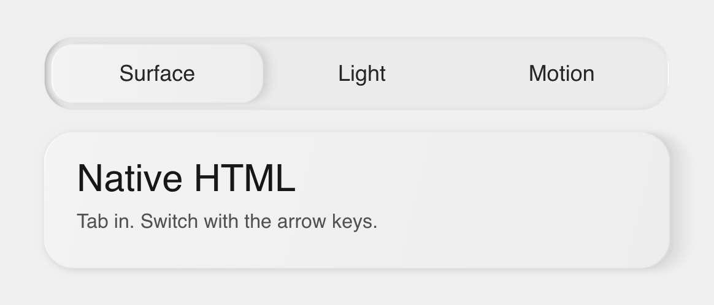

# OYN

A UI system built on native HTML with GPU-rendered materials. **WIP.**

A button is still a `<button>`. The browser lays it out, gives it focus, and handles activation. The GPU renders the material: a raised edge catches the light, a recessed track holds a shadow, and the highlight follows your pointer. Text and hit targets stay in the DOM.

## Packages

| Package | Responsibility |
| --- | --- |
| [Surface](packages/surface/) | Binds GPU rendering to DOM elements. HTML and CSS own layout. |
| [Ceramic](packages/ceramic/) | Computes highlights and shadows from geometry, elevation, and light. |
| [UI](packages/ui/) | Combines materials and motion with native controls. For composite widgets, Base UI or UI SDK handles selection and keyboard behavior. |

See the [architecture](ARCHITECTURE.md) for how the packages work together.
