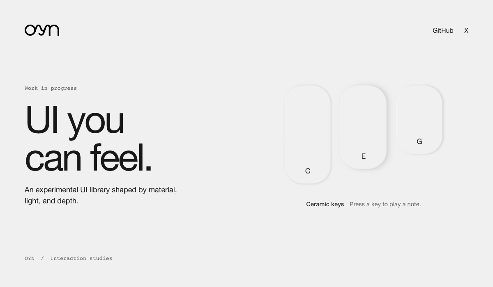

# OYN

**UI you can feel.** OYN is a work-in-progress UI library exploring how digital controls can convey depth without a drawn border. A raised ceramic key catches the light; a recessed track holds its shadow. Move the pointer and the highlight moves, but the underlying control is still HTML.

## What we're exploring

Can one material describe a button rising, a tab sliding into place, and a control sinking under pressure? The aim is for those states to read through light and elevation rather than a separate background color or outline for every state. Keyboard input, focus, and selection stay with the native element or its interaction library.

## How the project fits together

| Package | Responsibility |
| --- | --- |
| [Surface](packages/surface/) | Binds a rendered surface to a DOM element and schedules GPU draws. HTML and CSS still own layout. |
| [Ceramic](packages/ceramic/) | Turns geometry, light, and signed elevation into highlights and shadows. It knows nothing about buttons or tabs. |
| [UI](packages/ui/) | Connects native, Base UI, and UI SDK behavior to material and motion. |

The [Atelier](examples/atelier/) is the internal workshop. The [architecture notes](ARCHITECTURE.md) describe the boundaries between the packages, and the [64u wordmark](artifacts/brand/oyn-logo.svg) is the canonical brand asset.

This is a design and engineering study, not a stable release. The interfaces and materials are still changing.
