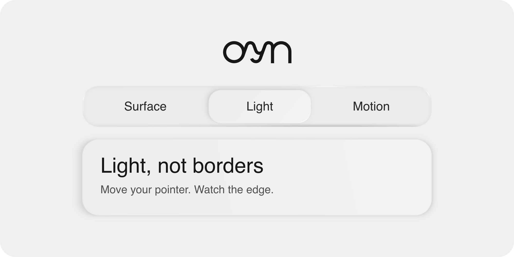

# [](https://oyn.dev/)

**UI you can feel**

OYN separates surface rendering from DOM structure. WebGPU materials draw the surfaces while native elements handle layout and interaction.

## Architecture

- **Your app** owns semantics, layout, interaction and animation.
- **Material** defines how a surface looks.
- **Core** binds materials to DOM elements and renders them with WebGPU.

## Develop

```sh
npm install
npm run build
npm run dev
```

## Website

The official [oyn.dev](https://oyn.dev/) homepage lives in `site/`. It consumes the
public package and is not an npm workspace. Run `npm run build:site` to build
`site/dist/`; Vercel publishes that directory on pushes to `main`.
