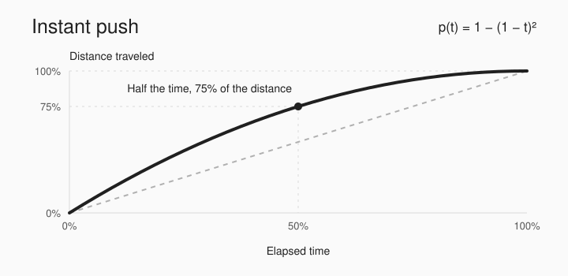

# Oyn UI

[ARCHITECTURE.md](../../ARCHITECTURE.md) is the authoritative ownership contract.

Oyn maintains a focused set of Ceramic controls for forms, navigation and
feedback, plus the standalone Card. The [Atelier catalog](../../examples/atelier/src/components/catalog.json)
lists the active SDK families and their previews. Each has a workspace import
such as `@oyn/ui/switch` and a source registry item such as `@oyn/ceramic-switch`.
Only exported components and their registry items are part of the distribution.

## Ready / Not ready

[Ready](ready.json) is the component worklist. To promote a family, add its catalog
ID (for example `"button"`, or `"card"` for the standalone Card) to that JSON array.
The entire family and its stories move together. Unlisted components default to
Not ready; leave them unchanged during Ready work. This does not change package
exports, registry items or existing preview URLs.

## Use a component

Give an existing ancestor the `oyn-ui` class to scope the layout styles. Mount
one OynProvider per document. The component's SDK root owns its value,
form participation, keyboard handling and accessible name.

```tsx
import { OynProvider } from "oyn/react";
import { Switch, SwitchThumb } from "@oyn/ui/switch";

<OynProvider>
  <main className="oyn-ui">
    <label data-slot="label">
      Show guides
      <Switch name="guides" defaultChecked>
        <SwitchThumb />
      </Switch>
    </label>
  </main>
</OynProvider>;
```

The material attaches to the SDK part's DOM ref. Native text inputs retain
their ref, label and caret inside a recessed frame. Compound inputs share one
frame. Calendar reads the SDK's day state to place a recessed strip across each
week of a selected range, including the raised start and end dates. The paging
buttons share corner centers with the surrounding calendar panel. Positive elevation gives buttons, cards, popup panels
and moving thumbs their form. Text, focus rings and data marks use CSS.

Open the [component catalog](http://127.0.0.1:5177/components.html) or
[Calendar range](http://127.0.0.1:5177/components.html?component=calendar&example=range).

### Button variants

The [variant comparison](http://127.0.0.1:5177/components.html?component=button&example=variants) shows the three Button variants. Only Primary adds a CSS fill: near-black in light themes, near-white in dark themes, reaching black or white on hover. Secondary and Ghost leave the underlying surface visible. Ceramic renders only the relief.

| Usage | Elevation: rest → hover → press |
| --- | --- |
| `<Button>Save</Button>` (default: `primary`) | 8 → 24 → 2 |
| `<Button variant="secondary">Cancel</Button>` | 8 → 24 → 2 |
| `<Button variant="ghost">More</Button>` | 0 → −2.8 → −8 |

Primary and Secondary intentionally share the raised profile. Ghost has no resting canvas. All three use the shared 150 ms elevation transition.

## Segmented Control

Use `@oyn/ui/segmented-control` for UI SDK or `@oyn/ui/base-ui/segmented-control` for Base UI. Both expose the same track appearance as Tabs, with no panel required. The root provides exactly one indicator; supply only the items.

```tsx
import { SegmentedControl, SegmentedControlItem } from "@oyn/ui/segmented-control";

<SegmentedControl aria-label="View" name="view" defaultValue="list">
  <SegmentedControlItem value="list">List</SegmentedControlItem>
  <SegmentedControlItem value="grid">Grid</SegmentedControlItem>
</SegmentedControl>;
```

[UI SDK preview](http://127.0.0.1:5177/components.html?component=segmented-control&example=basic) · [Base UI preview](http://127.0.0.1:5177/components.html?component=segmented-control&example=base-ui).

## Tabs

Two implementations of the same Ceramic tabs share one Surface runtime. Use React 19 and mount
`OynProvider` from `oyn` above the controls.

| Item | Interaction | Components to import in this workspace | Story |
| --- | --- | --- | --- |
| base-ui-ceramic-tabs-list | Base UI; no UI SDK or Tailwind | `CeramicTabsList` from `@oyn/ui/base-ui/tabs` | [Base UI Tabs](http://127.0.0.1:5177/?view=tabs&impl=base-ui) |
| ceramic-tabs-list | UI SDK; no Base UI, Tailwind or global SDK stylesheet | `CeramicTabsList` from `@oyn/ui/tabs` | [UI SDK Tabs](http://127.0.0.1:5177/?view=tabs) |

## Use the installed source

For Base UI, keep the root, tabs and panels. Replace only the list:

```tsx
import { Tabs } from "@base-ui/react/tabs";
import { CeramicTabsList } from "@/components/ui/base-ui-ceramic-tabs-list";

<Tabs.Root defaultValue="design">
  <CeramicTabsList aria-label="Workbench">
    <Tabs.Tab value="design">Design</Tabs.Tab>
    <Tabs.Tab value="code">Code</Tabs.Tab>
  </CeramicTabsList>
  <Tabs.Panel value="design">Preview</Tabs.Panel>
  <Tabs.Panel value="code">Source</Tabs.Panel>
</Tabs.Root>
```

For an existing UI SDK project, replace only its list:

```tsx
import { Tabs, TabsTab, TabsPanel } from "@ui-sdk/react/tabs";
import { CeramicTabsList, TabsPanels } from "@/components/ui/ceramic-tabs-list";

<Tabs defaultValue="design">
  <CeramicTabsList aria-label="Workbench" radius={16}>
    <TabsTab value="design">Design</TabsTab>
    <TabsTab value="code">Code</TabsTab>
  </CeramicTabsList>
  <TabsPanels>
    <TabsPanel value="design">Preview</TabsPanel>
    <TabsPanel value="code">Source</TabsPanel>
  </TabsPanels>
</Tabs>
```

Your existing controlled Tabs root and routing can stay in place. The list
adds the recessed track, one moving indicator and hover wells. To give the content the default raised Ceramic surface, wrap the SDK panels together in one `TabsPanels`. UI SDK still owns
the selected value and the indicator's measured bounds.

Not using either interaction library? Attach the Ceramic material directly with
`useMaterial({ material: ceramic, props })` under an OynProvider. The
[native button demo](http://127.0.0.1:5177/surface.html) is a material example, not an installable UI item.

## Source responsibilities



Shared control bindings interpret transient pointer/focus/keyboard feedback without
owning SDK actions or selection. The UI consumer computes a fixed-duration quadratic ease-out;
`bindMotion` from `oyn/adapters/motion` is its only writer to
`material.setElevation`. Ceramic receives instantaneous heights, not animation
targets or curves. Surface observes parameter changes and schedules GPU work.
Reduced motion, interruption and cancellation belong to this consumer source.
While drawable, animation updates retain the material and canvas; selection only
changes the resting height. Flat outline controls derive empty draw programs from
the same numeric source, letting Surface release the canvas without a second ref
lifecycle. CSS does not add press scaling or a second shadow to active Ceramic.

UI SDK and Base UI own selection, focus, keyboard behavior, forms and panel associations. `use-selection-track.ts` and `selection-track.css` provide the shared appearance. Track, indicator and panel use the automatic Ceramic finish. Hover relief is unpigmented so it reveals the underlying track. Inter-item spacing matches the track padding. Only an unselected item recesses on hover (0 → −4). Entry and return use Button’s 150 ms quadratic ease-out, reversing from the current height; reduced motion jumps directly to the target. Once the SDK selects it, the well disappears and the same raised indicator slides into place, even if the pointer stays down or over it. Tabs and UI SDK Segmented Control supply their own indicator measurements. Base UI RadioGroup has no moving group indicator, so its adapter measures only the SDK-checked radio for placement. CSS translates the indicator in 250 ms with the shared Instant push ease-out: it starts at maximum speed and decelerates uniformly to a stop, without animating canvas dimensions. The SDK panel contents crossfade in the same grid cell with the indicator’s timing and easing (both inherited from the Tabs root); their shared Ceramic surface stays mounted at full opacity. Reduced motion skips both transitions.

## Local registry

`npm run build:registry` builds static JSON from the root registry.json.
Atelier runs this before dev/build. After editing item source, rerun it to
refresh the installable JSON. Dev serves the catalog at `/r/registry.json`;
a production build puts it in `dist/r/`. Generated JSON is not committed.

For the full catalog, configure the Oyn namespace in your application's
`components.json`. The CLI resolves the shared files and each component's
dependencies using this URL.

```json
{
  "registries": {
    "@oyn": "http://127.0.0.1:5177/r/{name}.json"
  }
}
```

```sh
npx shadcn add @oyn/ceramic-switch @oyn/ceramic-calendar
```

The installed family modules live under your UI directory in `oyn/`.
The registry contains the same source used by the workspace imports.
Component layouts and documentation recipes are adapted from Vercel Labs'
UI SDK under Apache-2.0. The layout reference revision is
`855bc7fd4df3d61aee33d9d975dc3e4f71debc6c`. The license ships with the
shared files and is available in Atelier under `/recipe-source/LICENSE.txt`.

With a configured shadcn project and resolvable Oyn runtimes:

```sh
npx shadcn add http://127.0.0.1:5177/r/base-ui-ceramic-tabs-list.json
# Alternatively, for an existing UI SDK Tabs tree:
npx shadcn add http://127.0.0.1:5177/r/ceramic-tabs-list.json
```

The files go into your configured UI directory. The Base UI entries do not require UI SDK. The CLI is a development tool, not a runtime dependency.

**Release boundary:** the referenced OYN runtime version (0.0.0) is a local
workspace package, not public npm releases. For an external local install,
make the built `oyn` package available as an npm workspace (or in
a private registry) before running the commands. No public deployment or npm
publication is performed by these builds.

## Relief logo

`@oyn/ui/relief-logo` is a brand graphic, not an interactive control. Place it
inside an existing `OynProvider`; its width follows its container. Give it
a name with `aria-label`, or use `aria-hidden` when it is decorative. For a
static image, use the exported `@oyn/ui/relief-logo.svg` without React or a GPU.

```tsx
import { ReliefLogo } from "@oyn/ui/relief-logo";

<ReliefLogo lightAngle={0} style={{ width: 320 }} />
```

`lightAngle` (degrees) rotates only the gradient lighting, without deforming
or animating the mark. Each instance has one Surface binding; when the GPU is
unavailable, it displays the SVG with a fixed light direction.

In Atelier, open `/relief-logo.html` to compare light directions and download the
vector artwork. After editing the contours or gradients in
`tools/brand/relief.mjs`, run `node tools/brand/relief.mjs` to regenerate the SVG,
WGSL and WebGL2 mirrors together. Use `--check` to verify they match.
